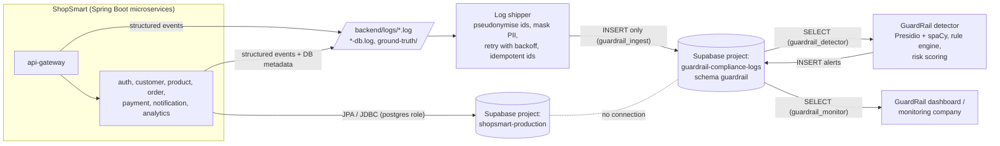

# ShopSmart and GuardRail: architecture and database separation

Two independent systems in one Supabase organization, each in its **own Supabase project** with its own PostgreSQL database, credentials and settings.

| | ShopSmart Production | GuardRail Compliance Logs |
|---|---|---|
| Supabase project | `shopsmart-production` | `guardrail-compliance-logs` |
| Holds | Customers, accounts, products, orders, payments references, addresses, consent, notifications | Privacy-preserving telemetry about ShopSmart: activity, database metadata, schema changes, alerts |
| Written by | The 7 ShopSmart Spring Boot services (as `postgres`, through the pooler) | The log shipper, as `guardrail_ingest` (insert only) |
| Read by | The ShopSmart services only | `guardrail_monitor` (read only), `guardrail_detector` (reads logs, writes alerts) |
| Never holds | Any GuardRail credential or role | Customer, order, address or payment tables |

## Data flow

**Arrows that do not exist:**
- GuardRail never connects to `shopsmart-production`.
- ShopSmart services never read the GuardRail database.
- The shipper never connects to production.

## How events travel

1. **Service writes a log line.** Each service writes structured `key=value` events to its log files: requests, consent, erasure, orders, payments, and database metadata with a query fingerprint and a normalised SQL template. Customer values are never written. The only exception is the `PII_IN_LOGS` demo scenario, which writes **synthetic** values and marks the line `demo=true synthetic=true`.
2. **The shipper reads it.** `tools/log-shipper/ship_logs.py` picks up new lines every 2 seconds and prepares them:
   - replaces `customer:N`, `admin:N` and `auth-user:N` with salted pseudonyms
   - masks emails, phone numbers, Aadhaar, PAN and card numbers in every event that is not a marked synthetic demo event
   - records which kinds of data were masked
3. **The shipper inserts the rows** as `guardrail_ingest`, with `on conflict do nothing`, so a re-sent event is a no-op. File positions are saved only after a commit; failures are retried with backoff and shown on screen and in `shipper-status.json`.
4. **The database files it.** A trigger copies schema changes into `schema_change_events`.
5. **GuardRail's detector reads the logs** and writes `compliance_alerts` and `detection_runs`. Reference SQL rules are in `supabase/guardrail-logs/03-reference-rules.sql`.

**Delivery guarantee (stated plainly):** at-least-once from log file to database, with duplicates removed by event id. This is a file-based outbox: an event logged by a service is delivered once the shipper runs and GuardRail is reachable. Log files rotate after 14 days, so an outage longer than that loses data. There is no transactional outbox inside each service's own database transaction.

## Access control

- **Database roles exist only in the project they belong to.** Supabase gives each project its own database cluster, so the GuardRail roles cannot authenticate to `shopsmart-production`. This is tested by logging in with the monitor's credentials against the production server.
- **Public API keys get nothing:**
  - GuardRail project: all tables are in schema `guardrail`, with `anon` and `authenticated` revoked and Row Level Security on.
  - Production project: Row Level Security is on for every table and API grants are revoked (`supabase/shopsmart-production/01-secure-tables.sql`).
- **Role permissions:**

  | Role | Can | Cannot |
  |---|---|---|
  | `guardrail_ingest` | INSERT log rows | read, update, delete, or change the schema |
  | `guardrail_monitor` | SELECT on logs, views, alerts, detection runs, schema changes and the service registry | write anything; read `violation_labels` (the answer key) |
  | `guardrail_detector` | SELECT on logs; INSERT and UPDATE on alerts and detection runs; UPDATE only `processing_status` on log rows | change log content; delete anything; read the answer key |

- **Organization membership is separate from database roles.** You own the organization.
  - On the Free and Pro plans, an organization member can open **every** project in it. So the monitoring company and the GuardRail team are **not invited**; they receive only the `guardrail_monitor` or `guardrail_detector` connection string.
  - Project-scoped roles, available on the Team plan, could limit a member to the logs project. Even so, a dashboard role there also sees the answer key, so the connection string remains the recommended route.
- **Demo switches** are off by default. Only ADMIN accounts can change them, checked on the server from the signed JWT. `DEMO_VIOLATIONS_ALLOWED=false` disables them for a deployment.

## Configuration: who reads which variable

| File | Variable | Read by |
|---|---|---|
| `shopsmart.env.bat` | `DB_URL`, `DB_USERNAME`, `DB_PASSWORD`, `DB_POOL_SIZE`, `DEMO_VIOLATIONS_ALLOWED` | ShopSmart backend services (via `start-backend.bat`) |
| `shopsmart.env.bat` | `SHOPSMART_PG_URL`, `SHOPSMART_PG_PASSWORD` | `tools/migrate/migrate_mysql_to_postgres.py` |
| `guardrail.env.bat` | `GUARDRAIL_INGEST_DB_URL`, `GUARDRAIL_INGEST_PASSWORD`, `GUARDRAIL_PSEUDONYM_SALT` | Log shipper only |
| GuardRail team (not in this repo) | `guardrail_monitor` and `guardrail_detector` connection strings | Monitoring company / GuardRail detector |
| `start-backend.bat` | `JWT_SECRET`, `INTERNAL_API_KEY`, `RAZORPAY_*`, `ADMIN_*` | ShopSmart backend services |
| Frontend (`VITE_*`) | none of the above | — No database or payment secret is ever in the React app |

`shopsmart.env.bat` and `guardrail.env.bat` are listed in `.gitignore`.

## Mapping to the requested tables

The ShopSmart services keep their existing tables and API contracts. The requested logical tables map onto them as follows:

| Requested | ShopSmart table(s) |
|---|---|
| customers / users | `customers`, `auth_users` (passwords stored only as BCrypt hashes) |
| products / categories | `products` (category is a column; the category list is fixed in product-service) |
| carts, cart_items | Kept in the browser and priced by `POST /orders/quote`; never stored server-side |
| orders / order_items | `customer_orders`, `order_line_items`, `order_status_history` |
| payments | `payments` (Razorpay order and payment ids and statuses only; no card data) |
| addresses | `customer_addresses`, plus an address snapshot on each order |
| notifications | `notifications` |
| consents | Consent columns on `customers` (purposes, notice version, timestamps), plus `consent_*` events in the logs |
| privacy_requests | Erasure requests (`customers.deletion_requested_at`, `erased_at`), plus `erasure_requested` / `retention_erasure` events |
| admin_users | `auth_users.role = 'ADMIN'`, enforced on the server |

Adding separate `carts`, `consents` or `privacy_requests` tables would change working service contracts, so they were not added.
